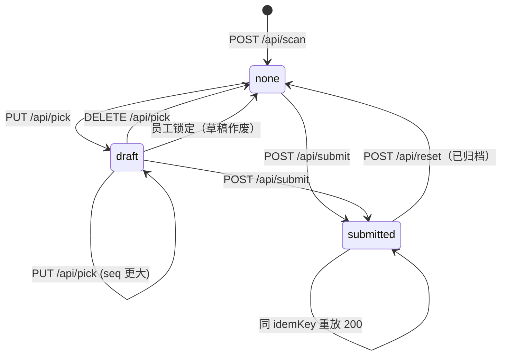
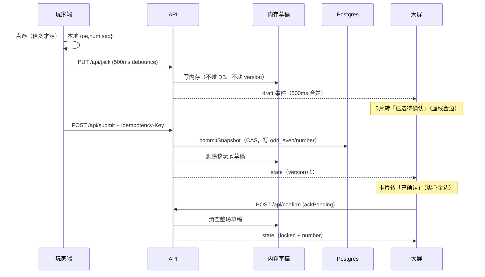

# 实时选择同步（草稿 → 确认提交）

> 单双竞猜门店互动版：玩家点选即刻出现在大屏上，但**只有按「确认提交」才算参赛**。
> 本文描述**已实现**的行为契约。对应代码：`server.js`（`/api/pick`、`/api/submit`、`/api/confirm`、草稿内存表）、`public/index/app.js`、`public/bigscreen/app.js`、`test/pick.test.mjs`。

---

## 0. 五条硬约束（其余设计都是它的推论）

| # | 约束 | 为什么 |
|---|---|---|
| C1 | **草稿只存进程内存，绝不落库** | `player.odd_even` 非空是「已提交」的唯一判据，归档、对账 CSV、命中判定、老玩家计数全看它。草稿写进去就等于参赛、等于中奖、进归档。 |
| C2 | **草稿不推进 `session.version`**，走独立的 `draft` 事件（局部补丁） | version 表征「已落库的状态」。草稿不动库，若用全量快照推送，客户端的版本判新旧逻辑会失效，还可能把过期快照盖回去。 |
| C3 | **不校验单双与数字的奇偶一致性** | 产品决定：点「单」也能点 4。前端网格不限制，服务端不拦。命中判定仍按数字奇偶走，会出现「选单、开 4 → 单双未中、数字中」的组合，属既定规则。 |
| C4 | **必须确认提交才算参赛**；未确认的草稿在锁定后作废，不补提交、不自动转正 | 避免「大屏上显示选了」被理解成「已经玩了」。技术上不做自动提交兜底，靠大屏三态 + 员工开奖前二次确认解决现场争议。 |
| C5 | **客户端 500ms debounce + 值真变才发**；服务端 500ms 合并广播 | 连点会打爆 CAS 与广播：10 人狂点能产生每秒几十次全量 JSON 推送。 |

另外两条实现层面的选择：

- **写接口只校验 `ut` 场次绑定，不校验 `pid` 归属**（沿用现有 `/api/predict` 的做法）。上线前若要堵「替别人点选」，需要给 `/api/scan` 加 `ptoken`，见 §9。
- **状态是二维的**：`choice`（none / draft / submitted）+ `presence`（in / left）。不合并成一个枚举，否则「已提交 + 已离开」这类组合会让状态爆炸。

---

## 1. 数据模型

### 1.1 落库的（不变）

```jsonc
// player 表；odd_even 非空 = 已确认提交
{ "id": "会员码内容", "odd_even": "单", "number": 5,
  "registered_at": 1763800000000, "submitted_at": 1763800015000, "left_at": null }
```

### 1.2 只在内存的（新）

```js
// server.js
draftStore     Map<sid, Map<pid, { oe:'单'|'双', num:0..9, seq:int, at:ms }>>
draftPending   Map<sid, Set<pid>>          // 待广播脏集合
draftTimers    Map<sid, Timeout>           // 500ms 合并窗口
submitReceipts Map<`sid|round|pid`, { idemKey, oddEven, number, at }>  // 提交幂等回执
```

生命周期：

| 事件 | 草稿 | 回执 |
|---|---|---|
| 提交成功 | 删该玩家的草稿 | 写入回执 |
| 员工锁定 `/api/confirm` | 整场清空（未确认 = 作废） | 保留（本轮内仍可重放） |
| 新一轮 `/api/reset`、关闭场次 | 整场清空 | 整场清空 |
| 实例重启 | **全部丢失** | **全部丢失** → 重放退化为 `already_submitted`，仍不会重复落库 |

### 1.3 对外投影

```jsonc
// GET /api/state 与 SSE state（★ = 本次新增）
{
  "ok": true,
  "session": { "id": "main", "name": "A场", "status": "open" },
  "version": 3312,
  "serverTime": 1763800016123,        // ★ 客户端校准时钟
  "round": 12,
  "locked": false,
  "counts": { "total": 10, "submitted": 6, "draft": 3, "none": 1, "left": 1 },  // ★
  "players": [
    // 玩家视图：只有状态，没有别人的选项
    { "id": "M1", "submitted": false, "status": "draft", "draft": true, "isVeteran": false },
    // 大屏视图（员工凭证）：带具体值与草稿值
    { "id": "M1", "status": "draft", "oe": "单", "num": 3,
      "oddEven": null, "number": null, "submitted": false,
      "draftOddEven": "单", "draftNumber": 3, "draftSeq": 7, "draftAt": 1763800010000,
      "left": false, "leftAt": null, "isVeteran": false,
      "registeredAt": 1763800000000, "submittedAt": null }
  ],
  "me": {                              // 玩家视角，需带 ?pid=
    "id": "M1", "oddEven": null, "number": null,
    "draft": { "oe": "单", "num": 3, "seq": 7 }   // ★ 刷新/重连靠它恢复选择
  }
}
```

字段语义（写死，别改）：

- `status`：`submitted` > `draft` > `none`。`left` 是独立维度，不参与。
- `submitted`：**只表示已确认提交**（库里 `odd_even` 非空）。统计、归档、老玩家计数只认它。
- `oe` / `num`：**显示值**，已提交取提交值、未提交取草稿值，都没有为 `null`。前端直接画，不自己判断优先级。
- `counts` 由服务端算，客户端不得自行统计（否则大屏和员工端会显示两个数）。

---

## 2. 状态流转



| # | 起始 | 事件 | 前置 | 结果 | 服务端动作 |
|---|---|---|---|---|---|
| T1 | none / draft | `PUT /api/pick` `seq > 当前 seq` | 未锁定、未提交 | draft | 写内存、标记脏、500ms 后广播 `draft` |
| T2 | draft | `PUT /api/pick` `seq <= 当前 seq` | — | 不变 | 不写、不广播，`200 { accepted:false, ignored:"stale_seq", draft }` |
| T3 | draft | `DELETE /api/pick` | `seq > 当前 seq` | none | 删内存、广播 `draft{ draft:null }` |
| T4 | none / draft | `POST /api/submit` 新 key | 未锁定、未提交 | submitted | 写 `odd_even/number/submitted_at`（CAS）、清草稿、写回执、广播 `state` |
| T5 | submitted | `POST /api/submit` 同 key | — | submitted | 不写库，`200 { replay:true }` |
| T6 | submitted | `POST /api/submit` 异 key | — | submitted | `409 already_submitted` + `submit` 终态 |
| T7 | submitted | `PUT/DELETE /api/pick` | — | submitted | `409 already_submitted` |
| T8 | none / draft | `POST /api/confirm` 未带 `ackPending` 且有草稿 | — | 不变 | `409 pending_confirm_required` + `counts` + `pending[]` |
| T9 | none / draft | `POST /api/confirm` 带 `ackPending` | — | 草稿作废 | 清草稿、锁定开奖；归档只计 `odd_even` 非空者 |
| T10 | 任意 | `POST /api/reset` | 上轮已归档 | none | 清 `players`、清草稿、清回执 |

**草稿不会产生持久状态**：锁轮即蒸发，不存在「已选未提交」的历史记录。

---

## 3. 接口

统一：JSON，成功 `{ ok:true, ... }`，失败 `{ ok:false, code:"snake_case" }`。

### 3.1 `PUT /api/pick` — 草稿上报（新增）

| 项 | 内容 |
|---|---|
| 认证 | 场次绑定令牌 `ut` |
| 请求 | `{ sid, ut, pid, oddEven:"单"|"双", number:0..9, seq:int>0 }` |
| 语义 | 覆盖式 upsert，只写内存 |

```jsonc
// 200 接受
{ "ok": true, "accepted": true, "seq": 7,
  "draft": { "oe": "单", "num": 3, "seq": 7 }, "version": 3312, "serverTime": 1763800010123 }

// 200 忽略（幂等/乱序）—— 不是错误，客户端用返回值覆盖本地
{ "ok": true, "accepted": false, "ignored": "stale_seq",
  "seq": 5, "draft": { "oe": "双", "num": 6, "seq": 5 }, "version": 3312, "serverTime": 1763800010123 }
```

| 状态 | code | 触发 |
|---|---|---|
| 400 | `pick_invalid_oe` / `pick_invalid` / `seq_invalid` / `pick_not_scanned` | 参数或身份不对 |
| 409 | `already_submitted` | 已确认提交（带 `submit` 终态） |
| 409 | `round_locked` | 本轮已锁定（带 `number`） |
| 403/409 | `session_need_unlock` / `session_locked` / `session_closed` | 场次准入失败 |

> 没有 `pick_mismatch`。单双与数字不校验奇偶一致（C3）。

### 3.2 `DELETE /api/pick` — 撤销草稿（新增）

请求 `{ sid, ut, pid, seq }`；响应 `{ ok, accepted, draft:null, version }`，`ignored` 可能是 `stale_seq` / `no_draft`。删除同样吃 `seq`，否则「删」与「改」乱序会留下幽灵选项。

### 3.3 `POST /api/submit` — 确认提交（新增）

| 项 | 内容 |
|---|---|
| 认证 | `ut` |
| 头 | `Idempotency-Key: <8–64 字符 [A-Za-z0-9_-]>`（必填；也接受小写 `idempotency-key`） |
| 请求 | `{ sid, ut, pid, oddEven, number }` |
| 语义 | 以本次 body 为准原子落库；不要求先有草稿 |

```jsonc
// 200 首次
{ "ok": true, "replay": false, "version": 3313,
  "counts": { "total": 10, "submitted": 7, "draft": 2, "none": 1, "left": 1 },
  "submit": { "oddEven": "单", "number": 3, "submittedAt": 1763800015000 } }

// 200 重放
{ "ok": true, "replay": true, "version": 3313, "submit": {...}, "counts": {...} }
```

| 状态 | code | 说明 |
|---|---|---|
| 409 | `already_submitted` | 异 key 重复提交，响应体带终态 → 前端展示成功而非报错 |
| 409 | `round_locked` | 锁定后到达，本轮作废 |
| 422 | `idempotency_key_required` | 缺头/格式不对 |
| 400 | `pick_invalid_oe` / `pick_invalid` / `pick_not_scanned` | 参数 |
| 409/500 | `write_conflict` / `write_failed` | 并发重试耗尽 / 落库失败 |

> 老接口 `POST /api/predict` **保留不变**（重复提交返回 `400 predict_duplicate`），仅供兼容。新前端一律走 `/api/submit`。

### 3.4 `GET /api/state` — 全量快照（扩展）

`?sid=&ut=|token=&pid=&view=player|bigscreen`。新增 `serverTime`、`counts`、`players[].status`、`me.draft`。`me` 需要带 `pid`。`view=bigscreen` **默认公开**（开奖前会暴露所有人选项，`BIGSCREEN_PUBLIC=0` 时恢复只认员工 `token`）。

### 3.5 `GET /api/stream` — SSE（扩展）

| 事件 | 负载 | 时机 |
|---|---|---|
| `state` | §1.3 全量，`id: <version>` | 首帧、任何**落库**变更 |
| `draft` | `{ sid, items:[{ pid, draft:{oe,num,seq,at} \| null }] }` | 草稿变化，按场次 500ms 合并，最多 1 次 |
| `session_closed` / `ping` | 沿用 | — |

`draft` 是唯一新增事件，**不带 `id`**：不参与 `Last-Event-ID` 对齐，重连首帧 `state` 会带出完整草稿状态。

### 3.6 `POST /api/confirm` — 员工锁定（扩展）

请求新增 `ackPending: true`，响应新增 `counts`。本轮有草稿且未 ack：

```jsonc
// 409
{ "ok": false, "code": "pending_confirm_required",
  "counts": { "total": 2, "submitted": 1, "draft": 1, "none": 0, "left": 0 },
  "pending": [ { "pid": "M2", "oddEven": "双", "number": 8, "seq": 1, "at": 1763800020000 } ] }
```

只卡**草稿**，不卡「压根没选」的人 —— 后者本来就没参赛意图，卡了只会挡住正常开奖。员工端先弹「还有 N 人未确认（其中 M 人已选未确认）」，确认后带 `ackPending` 重发；若再报 409（其他实例刚收到新草稿），最多再确认一次。

---

## 4. 提交流程



### 4.1 客户端（`public/index/app.js`）

- **点选**：`selOE`/`selNum` 变化 → `scheduleDraft()`；值没变直接 return（连点同一选项一个请求都不发）。
- **500ms debounce** → `flushDraft()`：与「服务端已确认的值」比（不是与「上次发送的值」比），所以 `单→双→单` 能正确发回，重复点击不发。
- **seq**：`oe_seq:<sid>` 存 localStorage，跨刷新只增，随每次发送带出。
- **本地草稿** `oe_draft:<sid>` = `{oe,num,seq,round}`：服务端只存内存，本地这份是「最终一致」的兜底。
- **确认提交**：`POST /api/submit` 带 `Idempotency-Key`（`oe_idem:<sid>`，成功后才删）；body 直接带最终选择，即使草稿请求还在路上也不会丢值。
- **重连/回前台**：`applyState` → `resumeDraft(s)`：已提交 → 清本地；服务端新 → 以服务端为准恢复界面；本地新或服务端没有 → 立即补发一次。

### 4.2 服务端（`server.js`）

- `putDraft/dropDraft/clearDrafts`：只改内存 + `markDraftDirty`。
- `flushDrafts(sid)`：500ms 到期把脏 pid 攒成一条 `draft` 事件推给该场次在线连接；没人在线直接跳过（内存仍在，首帧 `state` 会带出）。
- 跨实例：`publishDrafts()` 经 LISTEN/NOTIFY 转发**内容**（本项目唯一携带数据的通知，因为草稿不在库里、收端无从回读）。收端 `ingestRemoteDrafts` 按 seq 合并后走同一套 500ms 广播。
- 通知丢了不修：该实例暂时看不到草稿，玩家端重连补发即恢复。

---

## 5. 并发与幂等

| 场景 | 服务端 | 客户端表现 |
|---|---|---|
| 连点选项 | 500ms 合并，只处理最后一值 | 界面立即响应，无请求风暴 |
| 草稿乱序（seq 3 晚于 5） | `200 ignored:stale_seq` + 当前值 | 用返回值覆盖本地 |
| 同 seq 重发 | 视为同一请求，不改值 | 同上 |
| 双击提交（同 key） | 第一次落库，第二次 `200 replay:true` | 只弹一次成功 |
| 提交超时重试（同 key） | `200 replay` 或首次成功 | 一致 |
| 换设备/清缓存再提交 | `409 already_submitted` + 终态 | 展示「已提交」 |
| 提交与锁定并发 | CAS 落库顺序决定；输的一方 `round_locked` | 转「本轮已结束」 |
| 两实例同时提交同一玩家 | 本地写锁 + 版本 CAS → only-one-wins | 一个 200，一个 409 |
| 提交后另一设备改草稿 | `409 already_submitted` | 转只读 |

所有判定都在 `store.mutate()` 的 mutator 内完成（读最新快照后判断），不能先读后写。

---

## 6. 断线重连

服务端保证的部分（已有）：`retry: 2000`、首帧全量 `state`（`fresh` 读库）、`id: <version>` + `Last-Event-ID`、15s 心跳、跨实例 `applyRemote` 补齐、回前台主动 `GET /api/state`。

客户端只做一件事：**最终一致**，不做逐次重放。

```
onState(s):
  if s.me.oddEven != null  → 清本地草稿，UI 已提交
  srv = s.me.draft, loc = 本地草稿
  if loc.round != s.round  → 丢弃 loc
  if loc && (!srv || loc.seq > srv.seq) → 用 loc 恢复界面 + 补发一次
  else if srv → 用 srv 恢复界面
```

代价：断线期间连点多次只保留最后一次 —— 这正是要求。收益：没有离线队列、没有重放顺序问题。

---

## 7. 权限与校验

| 角色 | 凭证 | 读 | 写 |
|---|---|---|---|
| 玩家 | `ut`（场次绑定，12h） | 自己的 `me` + 公开 `players`（开奖前无他人选项） | 自己的 `pick` / `submit` |
| 员工 staff | `token` | `state`（status/counts）、`view=bigscreen` | `confirm` / `reset` / 账号 |
| 大屏 | 无（可选员工 `token` 用于回看已关闭场次） | `view=bigscreen`（含所有人选项） | 无 |
| 匿名 | — | 场次列表 | 无 |

服务端逐条硬校验：

| 字段 | 规则 | 失败码 |
|---|---|---|
| `sid` | 存在、`status=open` | `session_not_found` / `session_closed` |
| `ut` | HMAC 有效、未过期、绑定场次一致 | `session_need_unlock` / `session_locked` |
| `pid` | 必须在本场次 `players` 里 | `pick_not_scanned` |
| `oddEven` | `"单"` / `"双"` | `pick_invalid_oe` |
| `number` | 整数 0..9（含 0 和 9；0 是合法值，缺省不能当 0） | `pick_invalid` |
| `seq` | 正整数，`> 当前 seq` 才应用 | `seq_invalid` / `ignored:stale_seq` |
| `Idempotency-Key` | 8–64 位 `[A-Za-z0-9_-]` | `idempotency_key_required` |
| 轮次 | 未锁定 | `round_locked` |
| 重复 | 未提交 | `already_submitted` |

**已知缺口**：`pid` 来自 body，拿到 `ut` 就能替别人点选/提交。补法见 §9。

---

## 8. 落地清单（已完成）

| 位置 | 改动 |
|---|---|
| `server.js` | 草稿内存表 + `putDraft/dropDraft/clearDrafts/mergeDraft/flushDrafts/countChoices/choiceOf/pendingDraftsOf`、`publishDrafts/ingestRemoteDrafts/forgetReceipts` |
| `server.js` | 新增 `PUT/DELETE /api/pick`、`POST /api/submit`；`/api/predict` 原样保留 |
| `server.js` | `buildStatePayload` 增 `serverTime/counts/me.draft`；`publicPlayers` 增 `status/draft`；`bigscreenPlayers` 增 `status/oe/num/draft*` |
| `server.js` | `confirm` 增 `ackPending` + `pending`；锁定/关闭/新一轮清草稿与回执 |
| `server.js` | pubsub 事件分流：`type=draft` 走内存合并，其余走 `store.applyRemote` |
| `public/index/app.js` | 点选节流上报、`resumeDraft` 重连补发、提交改 `/api/submit` + 幂等键 |
| `public/bigscreen/app.js` | 三态卡片（虚线待确认）、`draft` 补丁事件、待确认计数 |
| `public/staff/app.js` | 开奖前区分「未提交」与「已选未确认」，`ackPending` 重试 |
| `public/shared/i18n.js` | 三语各补 4 个 key（306 个，三语对齐） |
| `test/pick.test.mjs` | 7 组用例：内存语义 / 视图隔离 / seq 单调 / 撤销 / 幂等 / 锁定竞态 / 重启恢复 |

---

## 9. 待办与已知取舍

1. **`ptoken` 未做**。写接口只认 `ut`，`pid` 由 body 指定 → 同一场次内可替他人点选。补法：`/api/scan` 返回 `ptoken = HMAC(pid|sid|exp)`，`pick/submit` 只认 token 解析出的 pid，忽略 body 里的 `pid`。改动集中在两个 handler + 玩家端 3 处调用。
2. **草稿重启即失**。可接受（客户端会补发），但频繁重启会出现「大屏短暂少几个人」。要持久化就得进 Redis 或加表 —— 与 C1 冲突，不做。
3. **大屏开奖后不显示「已作废」**。草稿锁定后直接消失、卡片回落到「未选择」。若要现场追责，可在 `bigscreenPlayers` 加 `voided` 标记（清空前快照一份）。
4. **单双与数字不校验一致性**（C3）。命中判定按数字奇偶走，属既定规则。
